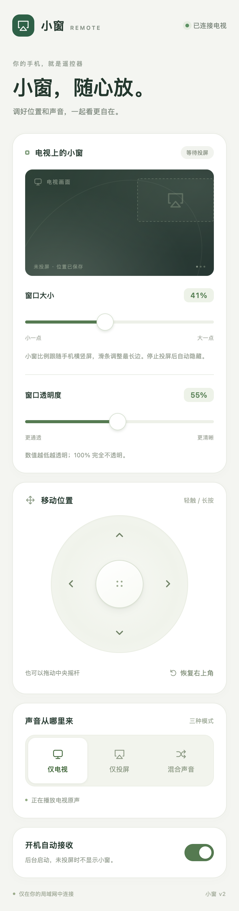

# TV AirPlay Float

**Keep your iPhone in a small window while the TV keeps playing.**

[简体中文](README.zh-CN.md) · [Documentation](docs/README.md) · [Build](docs/development/building.md) · [Dependencies](docs/dependencies.md) · [Contribute](CONTRIBUTING.md)

TV AirPlay Float is an Android TV AirPlay receiver with a frameless floating window and a mobile web remote. It is an independently maintained derivative of [android-airplay-server](https://github.com/jqssun/android-airplay-server), using its UxPlay-based receiver and native decoding stack.

| Platform | Source milestone | License |
| --- | --- | --- |
| Android 8.0+ / API 26+ | `v0.3.3` · app `0.3.3-opacity` | [GPL-3.0](LICENSE) |

## What it does

- **Watch together:** keep another TV app or HDMI input visible behind the mirrored phone.
- **Follow the phone:** adapt the window to portrait or landscape, and dock to the right on connection and aspect changes.
- **Control from your phone:** move with the joystick; adjust size, opacity and mirror volume in a browser.
- **Choose the sound:** TV only, mirror only, or both. Mixing is confirmed on the tested Xiaomi TV with HDMI input.
- **Stay out of the way:** show only after decoded video arrives; hide when mirroring stops.
- **Remember your preferences:** save window settings, mirror volume and the background-start preference.

No root, accessibility service, camera or microphone is required. ADB can assist installation and diagnostics; the receiver does not need a connected computer to run.

<details>
<summary>Mobile remote preview</summary>



The screenshot is rendered from the browser test fixture. It contains no household video or device capture.

</details>

## Quick start

1. [Build the APK](docs/development/building.md) and install it on your Android TV.
2. Open **AirPlay 投屏小窗**, allow display over other apps, and start receiving.
3. Return to the TV app or HDMI input. Put the iPhone and TV on a network that permits local discovery.
4. On iPhone, open **Control Center → Screen Mirroring → 电视投屏小窗**.
5. Open `http://<TV_IP>:8765` in your phone browser to adjust the window and sound.

The opacity slider ranges from 12–100%; lower values are more transparent. Reset restores the small top-right window and full opacity. Stopping Screen Mirroring hides the window.

The web remote currently uses **HTTP without a pairing code**. It is intended for a trusted local network; anyone able to access it can control this app's window and audio. See [security and network behavior](SECURITY.md).

## Compatibility

| Area | Current evidence |
| --- | --- |
| Device | Xiaomi MiTV-MTEQ0, Android 10, ARM32 |
| Input | iPhone Control Center screen mirroring; H.264 receiver configuration |
| HDMI | Overlay and simultaneous TV/mirror audio confirmed on this device |
| Window | Movement, size, rotation and right docking confirmed by the tester |
| Opacity | Browser and device HTTP checks passed; separate visual acceptance is pending |
| Startup | Package-update startup and simulated quick boot passed; physical power-cycle verification is pending |

Other TVs, HDMI routes and external audio systems need their own checks. Audio focus and vendor firmware affect mixing. DRM content is unsupported; direct AirPlay video URL/HLS playback is disabled in this derivative. See the [compatibility record](docs/validation/README.md).

## Build and check

Clone this repository using its clone URL with `--recurse-submodules`, then run:

```sh
git submodule update --init --recursive
./gradlew --no-daemon :app:assembleDebug :app:lintDebug :app:testDebugUnitTest -PtargetAbi=armeabi-v7a
```

Requires JDK 21, Android SDK Platform 37.0, build-tools 36.0.0, NDK 27.0.12077973 and CMake 3.22.1. Output: `app/build/outputs/apk/debug/app-debug.apk`. Setup, other ABIs and signing are covered in the [build guide](docs/development/building.md).

Repository checks require Python 3.11+; browser fixtures require Node 20+:

```sh
python3 tools/repo_check.py
npm ci --prefix tools
npm run browsers --prefix tools
npm test --prefix tools
```

See [testing](docs/development/testing.md) for the difference between fixture tests and hardware validation.

## Code map

| Location | Responsibility |
| --- | --- |
| `app/src/main/kotlin/.../floating/` | Window geometry, overlay lifecycle and TV controls |
| `app/src/main/kotlin/.../remote/` | LAN HTTP API and mirror audio policy |
| `app/src/main/kotlin/.../service/` | Receiver, discovery, window and audio orchestration |
| `app/src/main/kotlin/.../renderer/` | MediaCodec, EGL and audio output integration |
| `app/src/main/cpp/` | JNI, protocol callbacks, PCM and native builds |
| `app/src/main/assets/remote/` | Self-contained mobile web remote |
| `tools/` | Repository, browser and opt-in device checks |
| `docs/` | Usage, architecture, dependencies and dated validation |

Start with the [architecture guide](docs/development/architecture.md). The upstream Kotlin/JNI namespace remains `io.github.jqssun.airplay`; the installed application ID is `dev.czp.tvairplay`.

## Contributing and provenance

Read [CONTRIBUTING.md](CONTRIBUTING.md) before changing the project. Coding agents should also read [AGENTS.md](AGENTS.md). Bugs should include device/Android versions, input and audio route, reproduction steps, and which behavior was actually observed.

The base is [android-airplay-server at a46cca0](https://github.com/jqssun/android-airplay-server/tree/a46cca0a6a1274e9e33c0e750f0f1c1eb1d881ea). This project is separate from CleanYourTV and does not require its launcher or cleanup scripts. Upstream commits, copyrights and license texts are preserved.

- [Changelog](CHANGELOG.md)
- [Dependency inventory](docs/dependencies.md)
- [Third-party notices](THIRD_PARTY_NOTICES.md)
- [License](LICENSE)
