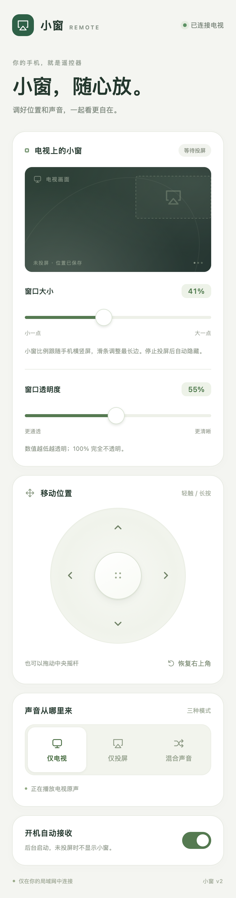

# TV AirPlay Float · AirPlay 投屏小窗

**电视继续播放，手机画面放在小窗里。**

[English](README.md) · [文档目录](docs/README.md) · [构建说明](docs/development/building.md) · [依赖说明](docs/dependencies.md) · [参与贡献](CONTRIBUTING.md)

这是一个无需 root 的 Android TV AirPlay 悬浮投屏接收器，带手机网页遥控器。基于 [android-airplay-server](https://github.com/jqssun/android-airplay-server) 独立维护，复用上游 AirPlay/UxPlay 协议与解码实现，与 CleanYourTV 清广告、换桌面项目分开。

| 平台 | 首个源码里程碑 | 许可证 |
| --- | --- | --- |
| Android 8.0+ / API 26+ | `v0.3.3`，应用 `0.3.3-opacity` | [GPL-3.0](LICENSE) |

## 功能

- **继续看电视**：手机镜像显示为小窗，其他 TV App 或 HDMI 输入保持可见。
- **自动适配横竖屏**：按实际画面比例调整窗口，开始投屏与比例改变后自动贴到最右侧。
- **手机网页遥控**：摇杆移动、调整大小、透明度和投屏音量。
- **三种声音模式**：仅电视、仅投屏、混合声音；已在测试电视的 HDMI 场景确认两路同时发声。
- **空闲自动隐藏**：解码出真实视频后显示，停止镜像后隐藏，没有等待画面或标题按钮。
- **保存设置**：记住窗口设置、投屏音量和后台自启偏好。

不需要 root、无障碍、摄像头或麦克风。ADB 用于安装和诊断；运行接收器不需要电脑保持连接。

<details>
<summary>手机遥控器预览</summary>



图片来自浏览器测试的模拟状态，不含家庭媒体或电视截图。

</details>

## 开始使用

1. 按[构建说明](docs/development/building.md)生成 APK 并安装到电视。
2. 打开 **AirPlay 投屏小窗**，允许显示在其他应用上层，开启接收。
3. 返回电视节目或 HDMI 输入，确保手机与电视所在网络允许局域网发现。
4. iPhone 控制中心 → 屏幕镜像 → **电视投屏小窗**。
5. 手机浏览器打开 `http://<TV_IP>:8765`，移动窗口或调整画面和声音。

透明度范围为 12–100%，数值越低越透明；恢复右上角会恢复小窗和完全不透明。停止屏幕镜像后窗口自动隐藏。

当前网页使用 **HTTP，免配对码**，面向可信局域网。能访问该地址的人可以控制本应用窗口和声音。网络行为及安全报告方式见 [SECURITY.md](SECURITY.md)。

## 已验证范围

| 项目 | 证据 |
| --- | --- |
| 设备 | 小米 MiTV-MTEQ0，Android 10，ARM32 |
| 投屏 | iPhone 控制中心屏幕镜像，当前配置 H.264 |
| HDMI | 小窗叠加和电视/投屏混音已现场确认 |
| 窗口 | 移动、缩放、横竖屏、自动靠右已现场确认 |
| 透明度 | 浏览器和电视 HTTP 检查通过，单独视觉验收待确认 |
| 自启 | 安装更新后启动与模拟快速开机通过，真实开机待确认 |

其他电视、HDMI 音频路径和外接音响需要独立验证。不支持 DRM；此派生版本没有启用独立 AirPlay 视频 URL/HLS 播放。[验证记录](docs/validation/README.md)区分自动检查和真实观感。

## 构建与检查

克隆公开仓库及固定版本的子模块，然后构建：

```sh
git clone --recurse-submodules https://github.com/czp-cloud/tv-airplay-float.git
cd tv-airplay-float
./gradlew --no-daemon :app:assembleDebug :app:lintDebug :app:testDebugUnitTest -PtargetAbi=armeabi-v7a
```

工具链：JDK 21、Android SDK Platform 37.0、build-tools 36.0.0、NDK 27.0.12077973、CMake 3.22.1。输出 `app/build/outputs/apk/debug/app-debug.apk`。其他架构、代理和签名见[构建说明](docs/development/building.md)。

```sh
python3 tools/repo_check.py
npm ci --prefix tools
npm run browsers --prefix tools
npm test --prefix tools
```

仓库检查需要 Python 3.11+，浏览器测试需要 Node 20+。手机网页运行不需要 npm；Node/Playwright 只用于开发测试。[测试说明](docs/development/testing.md)包含硬件检查的使用范围。

## 开发入口

- [架构与代码地图](docs/development/architecture.md)
- [窗口实现](docs/implementation/overlay.md)
- [网页遥控器与 HTTP API](docs/usage/web-remote.md)
- [依赖版本与来源](docs/dependencies.md)
- [贡献指南](CONTRIBUTING.md)与 [AGENTS.md](AGENTS.md)
- [变更记录](CHANGELOG.md)、[第三方声明](THIRD_PARTY_NOTICES.md)、[许可证](LICENSE)

应用 ID 为 `dev.czp.tvairplay`；Kotlin/JNI 命名空间保留上游的 `io.github.jqssun.airplay`。上游基线为 [a46cca0](https://github.com/jqssun/android-airplay-server/tree/a46cca0a6a1274e9e33c0e750f0f1c1eb1d881ea)，相关历史与版权保留。
