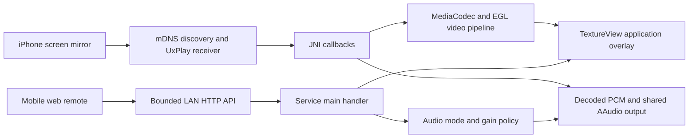

# Architecture

## End-to-end path

AirPlayService owns the receiver, network discovery, overlay and audio policy. Native callbacks report stream state; main-thread dispatch serializes window and audio-policy changes. The audio/video paths are inherited from the upstream receiver and integrated with this derivative's controls.

## Main components

| Component | Role |
| --- | --- |
| service/AirPlayService.kt | Lifecycle, JNI callbacks, discovery and command orchestration |
| discovery/NsdServiceManager.kt | Advertise receiver services |
| renderer/VideoRenderer.kt | Decoder selection, MediaCodec input/output and first-decoded-frame callback |
| renderer/VideoPipeline.kt | Persistent decoder SurfaceTexture and EGL display-surface rendering |
| floating/MirrorOverlay.kt | TYPE_APPLICATION_OVERLAY, TextureView and persisted controls |
| floating/OverlayGeometry.kt | Aspect-preserving dimensions and longest-edge bounds |
| remote/RemoteControlServer.kt | Fixed assets/routes, request validation and bounded main-handler commands |
| remote/MirrorAudioController.kt | TV/mirror/mixed state, focus and per-receiver gain |
| renderer/AudioRenderer.kt | Native audio integration |
| app/src/main/cpp/ | Protocol glue, AAC/ALAC decode, timeline buffer and PCM output |
| BootReceiver.kt | Preference-gated startup on system events |

Kotlin paths in the table are relative to app/src/main/kotlin/io/github/jqssun/airplay. The installed app ID is dev.czp.tvairplay; the upstream namespace remains in JNI, classes and action names.

## Overlay lifecycle

1. The service receives and decodes even without a visible overlay.
2. A real video-size callback updates the aspect and preferred size.
3. The first decoded frame schedules window display on the main handler, guarded against a stale mirror session.
4. Rotation changes the window ratio and docks its right edge. A screen-bounded longest edge prevents oversize portrait windows; the saved preference allows a later landscape size to recover.
5. Disconnection removes the visible window/surface while the receiver remains available.

FLAG_NOT_FOCUSABLE preserves the underlying task's input focus. A TextureView is an output surface owned by this app; the TV's HDMI video is not captured or embedded by this receiver.

## Audio

- TV mode closes this app's local output and releases its focus.
- Mirror mode requests transient exclusive focus and enables decoded output.
- Mixed mode releases this app's exclusive focus and enables shared output, allowing the tested TV's audio path to mix it.
- The volume slider changes this app's PCM gain, not Android's global media volume.
- The output requires a real mirror session and an announced audio format. Disconnection returns policy to TV mode.

Actual mixing depends on the TV/player/vendor route. This project does not capture HDMI PCM or isolate TV audio into a particular physical speaker. Details and source references are in [audio-routing research](../research/audio-routing.md).

## Boundaries

The remote serves local assets only and has no shell/file-reading API. Its current unauthenticated HTTP behavior is documented in [SECURITY.md](../../SECURITY.md).

The source tree retains upstream UI and direct-video machinery for provenance and future work. Their presence does not mean those entry points are enabled in this derivative. Runtime settings and service code determine the supported path.
